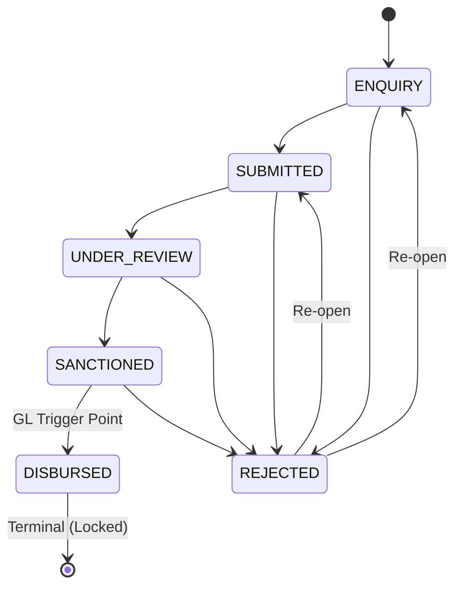
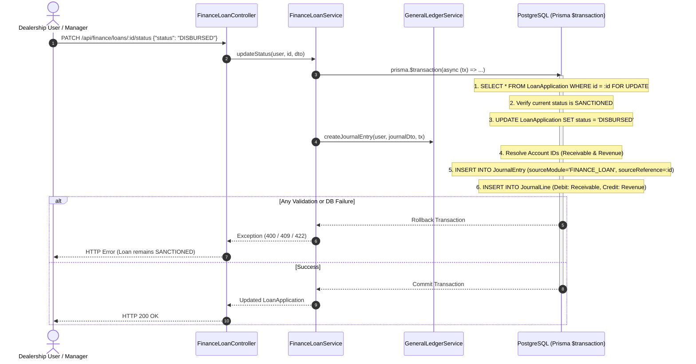

# Nexus ERP — Finance & Loan Desk to General Ledger Integration Readiness Audit

> **Document Status:** Complete Integration Readiness Audit & Architectural Blueprint  
> **Source of Truth:** Codebase state on branch `feature/finance-loan-backend-v2`  
> **Target Audience:** Engineering Management, Finance & Accounting Team (Akash), Technical Lead, Dealership Operations  

---

## 1. Executive Summary

This readiness audit evaluates the technical and financial prerequisites for connecting the **Finance & Loan Desk** (`FinanceLoanModule`) with the **General Ledger** (`GeneralLedgerModule`) in Nexus ERP.

### Repository Baseline
- **Branch:** `feature/finance-loan-backend-v2`
- **General Ledger Foundation:** Fully implemented in `backend/src/modules/general-ledger/`.
- **Database Status:** PostgreSQL migration `20261022144500_add_general_ledger_foundation` applied to `nexus_erp` (port 5433).
- **Test Baseline:** 61 backend unit tests passing; 15 real-database integration tests passing against live PostgreSQL.
- **Current Integration State:** **Decoupled (Zero GL Coupling)**. Advancing a loan to `DISBURSED` currently updates `LoanApplication.status` in isolation with no journal entries posted, no accounting transactions initiated, and no cross-module dependencies wired.

---

## 2. Existing Implementation Analysis

### 2.1 Backend Modules & Architecture
| Module | Current Scope & Services | Controllers & Endpoints | Ledger Readiness |
| :--- | :--- | :--- | :--- |
| **`FinanceLoanModule`** | `FinanceLoanService` manages loan lifecycle, FSM validation, commission calculation, and branch access control. | `FinanceLoanController` (`/api/finance/loans`): `GET /`, `GET /metrics`, `POST /`, `GET /:id`, `PATCH /:id/status`. | No GL dependency injected; uses isolated `prisma.loanApplication.update()`. |
| **`GeneralLedgerModule`** | `GeneralLedgerService` enforces double-entry invariants, integer cent balancing, multi-branch access, source idempotency, and journal lifecycle (`DRAFT`, `POSTED`, `VOID`). | `GeneralLedgerController` (`/api/ledger`): Accounts (`POST /accounts`, `GET /accounts`, `GET /accounts/:id`) and Journals (`POST /entries`, `GET /entries`, `GET /entries/:id`, `PATCH /entries/:id/post`, `PATCH /entries/:id/void`). | **Ready for integration:** `createJournalEntry()` explicitly supports `externalTx?: Prisma.TransactionClient`. |
| **`PrismaModule`** | Shared database connectivity via `PrismaClient`. | N/A | Supports interactive `$transaction`. |

### 2.2 Prisma Schema & Data Models
1. **`LoanApplication` (`schema.prisma`):**
   - Key financial fields: `loanAmount (Decimal(14,2))`, `interestRate (Decimal(5,2))`, `tenureMonths (Int)`, `commissionAmount (Decimal(12,2))`.
   - Foreign keys: `branchId -> Branch.id (ON DELETE RESTRICT)`, `submittingUserId -> User.id (ON DELETE RESTRICT)`.
   - **Missing GL fields:** Currently has no `journalEntryId` or reference back to the ledger.
2. **`JournalEntry` (`schema.prisma`):**
   - Fields: `id`, `entryNumber (unique)`, `entryDate`, `postingDate`, `status (DRAFT, POSTED, VOID)`, `sourceModule`, `sourceReference`, `narration`, `branchId`, `createdById`.
   - Constraints: `@@unique([sourceModule, sourceReference])`. This constraint provides built-in database-level idempotency protection.
3. **`JournalLine` (`schema.prisma`):**
   - Fields: `id`, `journalEntryId (ON DELETE CASCADE)`, `accountId (ON DELETE RESTRICT)`, `description`, `debitAmount (Decimal(14,2))`, `creditAmount (Decimal(14,2))`.

---

## 3. Detailed Loan Lifecycle & Disbursement Audit

### 3.1 Status Transitions & Finite State Machine (FSM)
In `FinanceLoanService`, the lifecycle is controlled by `ALLOWED_STATUS_TRANSITIONS`:

```typescript
const ALLOWED_STATUS_TRANSITIONS: Record<LoanStatus, LoanStatus[]> = {
  [LoanStatus.ENQUIRY]: [LoanStatus.SUBMITTED, LoanStatus.REJECTED],
  [LoanStatus.SUBMITTED]: [LoanStatus.UNDER_REVIEW, LoanStatus.REJECTED],
  [LoanStatus.UNDER_REVIEW]: [LoanStatus.SANCTIONED, LoanStatus.REJECTED],
  [LoanStatus.SANCTIONED]: [LoanStatus.DISBURSED, LoanStatus.REJECTED],
  [LoanStatus.DISBURSED]: [], // Terminal state
  [LoanStatus.REJECTED]: [LoanStatus.ENQUIRY, LoanStatus.SUBMITTED], // Allow re-opening
};
```



### 3.2 Where and How Disbursement is Validated
Disbursement occurs when a client sends `PATCH /api/finance/loans/:id/status` with `{"status": "DISBURSED"}`:
1. **Branch Access Check:** `verifyBranchAccess(user, loan.branchId)` verifies the caller has rights to the loan's branch or has the `SYSTEM_ADMIN` role.
2. **FSM Transition Gate:** Checks whether `ALLOWED_STATUS_TRANSITIONS[currentStatus]` includes `DISBURSED`. Transition to `DISBURSED` is **strictly permitted only from `SANCTIONED`**.
3. **Current DB Execution:**
   ```typescript
   // backend/src/modules/finance-loan/finance-loan.service.ts
   return await this.prisma.loanApplication.update({
     where: { id: cleanId },
     data: { status: nextStatus },
     include: { ... },
   });
   ```
   **Critical Finding:** The update is currently executed as an isolated single-table query. It does **not** use `prisma.$transaction`.

### 3.3 Handling of Duplicate Disbursement Requests
- **No-Op Status Check:** `if (currentStatus === nextStatus) return this.findOne(user, cleanId);`. If a client resends `DISBURSED` on a loan already marked `DISBURSED`, it safely returns the existing record without doing anything.
- **Race Condition Exposure:** If two requests arrive concurrently while status is `SANCTIONED`, both could pass the `currentStatus === nextStatus` check before either completes the update. Wrapping this in a transaction with database-level uniqueness (`sourceModule + sourceReference`) will prevent duplicate ledger postings.

### 3.4 Support for Reversals, Cancellations, or Rescissions
- **Current Support:** **None.**
- `ALLOWED_STATUS_TRANSITIONS[LoanStatus.DISBURSED] = []`. Once a loan is marked `DISBURSED`, any attempt to alter its status throws:
  `BadRequestException: "This application is in a terminal state and cannot be changed."`
- In real-world automotive finance, loans can occasionally be cancelled, rescinded during cooling-off periods, or subject to commission clawback by the lender.
- Currently, there is no loan reversal endpoint, no cancellation workflow, and no integration with `GeneralLedgerService.voidJournalEntry()`.

---

## 4. Accounting Decisions Requiring Formal Approval

Before implementing the integration, the following accounting policies and configuration values must be approved by the Finance Controller / Accounting Stakeholders. **These values must not be hardcoded or assumed.**

| # | Item / Decision | Current Placeholder / Prototype | Options & Production Considerations | Primary Stakeholder |
| :-: | :--- | :--- | :--- | :--- |
| **1** | **Commission Receivable Account** | Code `1100` ("Accounts Receivable") in frontend prototype | Should commission receivable be posted to a generic AR account (`1100`), a dedicated control account (e.g. `1150 - Lender Commission Receivable`), or distinct sub-accounts per lender (e.g. HDFC, NBFCs)? | Finance Controller |
| **2** | **Commission Revenue Account** | Code `4300` ("Finance & Insurance Commission") in frontend prototype | Confirm official code and naming under the dealership's Chart of Accounts (e.g. `4300 - F&I Commission Income`). | Head of Accounting |
| **3** | **GST / Indirect Tax Treatment** | Prototype includes `2100` ("GST Payable"), but does not specify calculation | In India, dealership commission is subject to 18% GST (9% CGST + 9% SGST intra-state, or 18% IGST inter-state):<br>• Is `commissionAmount` stored in `LoanApplication` **gross** (GST-inclusive) or **net** (base commission)?<br>• Should the journal entry split GST into output liability at disbursement, or does GST recognition occur only upon generating a formal B2B Tax Invoice to the lender? | Tax Compliance Officer |
| **4** | **TDS (Tax Deducted at Source)** | Not represented anywhere in codebase | Lenders in India frequently deduct 2% or 5% TDS under Section 194H of the Income Tax Act upon payout. Should TDS be recognized upon disbursement or upon bank reconciliation / payment receipt? | Tax Compliance Officer |
| **5** | **Zero-Commission Handling** | `commissionAmount` can be `0.00` | In `schema.prisma`, `commissionAmount` defaults to `0.00`. In `GeneralLedgerService`, journal lines with ₹0.00 are rejected (`debit and credit cannot be neither`). If a loan has `commissionAmount = 0.00`, should the GL posting be bypassed, or should disbursement of a ₹0 commission loan be rejected? | Dealership General Manager |
| **6** | **Branch Scope of Accounts** | All prototype accounts have `branchId: null` | Are revenue and receivable accounts centralized at the Head Office level (`branchId: null`), or must each branch have its own dedicated sub-accounts? | Lead Accounting Architect |
| **7** | **Disbursement Authorization Role** | Any branch employee can currently disburse | Should the ability to transition a loan to `DISBURSED` (which triggers financial revenue recognition) be restricted to a specific role (e.g. `FINANCE_MANAGER`, `BRANCH_MANAGER`) or permission (`FINANCE_DISBURSE`)? | Operations / Security Lead |
| **8** | **Reversal & Clawback Policy** | No cancellation permitted | If a disbursed loan is cancelled, should the system support: (a) Voiding the original journal entry via `GeneralLedgerService.voidJournalEntry()`, or (b) Creating an explicit credit-note / reversing journal entry (`sourceModule = 'FINANCE_LOAN_REVERSAL'`)? | Chief Financial Officer |

---

## 5. Frontend Contract Review & Gap Analysis

### 5.1 Finance & Loan Desk Frontend (`FinanceLoan.tsx`)
1. **Mock In-Memory State:** `FinanceLoan.tsx` relies completely on a static `initialApplications` array. It performs **no REST API requests** (`fetch` / `axios` / API client).
2. **Payload Property Mismatches:**
   | Frontend Field (`FinanceLoan.tsx`) | Backend Field (`CreateLoanDto`) | Discrepancy & Required Fix |
   | :--- | :--- | :--- |
   | `customer: string` | `customerName: string` | Property name mismatch. |
   | `lender: string` | `lenderName: string` | Property name mismatch. |
   | `amount: number` | `loanAmount: number` | Property name mismatch. |
   | `rate: number` | `interestRate: number` | Property name mismatch. |
   | `tenure: string` (in modal state) | `tenureMonths: number` | Not passed in `onSave` payload; backend requires `IsInt` between 1 and 360. |
   | *(Missing in modal)* | `branchId: string` | Backend strictly requires `branchId`. Frontend has no branch selector. |
3. **Status Update Gap:** The UI has a `<StatusBadge status={...} />`, but lacks any action button, dropdown, or workflow to advance an application from `SANCTIONED` to `DISBURSED` via `PATCH /api/finance/loans/:id/status`.

### 5.2 Finance Accounting Frontend (`FinanceAccounting.tsx`)
1. **Mock In-Memory Data:** Uses hardcoded arrays for accounts and journal entries (`journalEntries: JournalEntry[]`).
2. **Schema Shape Mismatches:**
   - The frontend assumes a flattened journal representation:
     `{ entry: string, date: string, account: string, branch: string, debit: string, credit: string, narration: string }`
   - The real backend architecture uses a master-detail structure:
     `JournalEntry` containing an array of `lines: JournalLine[]` (`accountId`, `debitAmount`, `creditAmount`, `description`).
3. **Currency & Precision Formatting:** Frontend assumes pre-formatted strings (`"₹8,87,925"`), whereas the backend returns numeric primitives and ISO date strings.

---

## 6. Technical Integration Architecture & Design

### 6.1 Transactional Atomicity (Prisma Interactive Transaction)
To guarantee that a loan is **never marked `DISBURSED` without its corresponding ledger entry** (and conversely, that a journal entry is never created if the loan update fails), both operations must execute within a single PostgreSQL database transaction:



### 6.2 Idempotency & Concurrency Protection
1. **Source Module & Reference Key:**
   - `sourceModule: 'FINANCE_LOAN'`
   - `sourceReference: loan.id`
   - The PostgreSQL database enforces `@@unique([sourceModule, sourceReference])` on table `JournalEntry`.
2. **Concurrent Request Handling:**
   - If two identical disbursement requests execute at the same microsecond, one transaction will acquire the row update first.
   - The second transaction will either detect that the status is already `DISBURSED` (handled gracefully by the early-return check) or will collide on the unique index in PostgreSQL (`P2002`), which `GeneralLedgerService` translates to `ConflictException(409)`.
   - **Result:** It is physically impossible to create duplicate journal entries for a single loan application.

### 6.3 Account Resolution Strategy
`GeneralLedgerService.createJournalEntry()` requires `accountId` (the primary key UUID of `Account`), not the string account code.
- **Recommended Pattern:** Create an internal ledger configuration resolver (e.g. `LedgerConfigService` or account lookup query) that resolves the active account UUIDs for the configured codes (e.g. `COMMISSION_RECEIVABLE` and `COMMISSION_REVENUE`).
- **Validation:** Ensure resolved accounts:
  1. Exist in PostgreSQL.
  2. Have `isActive: true`.
  3. Match the loan's `branchId` OR have `branchId: null` (global account).

### 6.4 Journal Entry Payload Structure (Net Commission Model)
When a loan with `commissionAmount: 15000.00` is disbursed:

```typescript
const journalDto: CreateJournalEntryDto = {
  entryDate: new Date(),
  narration: `Loan Disbursement Commission — Customer: ${loan.customerName}, Lender: ${loan.lenderName}, Application: ${loan.id}`,
  branchId: loan.branchId,
  status: JournalStatus.POSTED,
  sourceModule: 'FINANCE_LOAN',
  sourceReference: loan.id,
  lines: [
    {
      accountId: receivableAccountId,
      description: `Commission Receivable from ${loan.lenderName} (${loan.customerName})`,
      debitAmount: 15000.00,
      creditAmount: 0.00,
    },
    {
      accountId: revenueAccountId,
      description: `F&I Commission Revenue — Loan ${loan.id}`,
      debitAmount: 0.00,
      creditAmount: 15000.00,
    },
  ],
};
```

---

## 7. Required Code Changes (Implementation Plan)

### Phase 1: Module Wiring & Dependency Injection
1. **[`backend/src/modules/finance-loan/finance-loan.module.ts`](file:///c:/Users/goudt/OneDrive/Desktop/intern/ERP/backend/src/modules/finance-loan/finance-loan.module.ts):**
   - Import `GeneralLedgerModule`.
2. **[`backend/src/modules/finance-loan/finance-loan.service.ts`](file:///c:/Users/goudt/OneDrive/Desktop/intern/ERP/backend/src/modules/finance-loan/finance-loan.service.ts):**
   - Inject `GeneralLedgerService` into `FinanceLoanService` constructor:
     ```typescript
     constructor(
       private readonly prisma: PrismaService,
       private readonly ledgerService: GeneralLedgerService,
     ) {}
     ```

### Phase 2: Transactional Disbursement Method
3. Refactor `FinanceLoanService.updateStatus()`:
   - When `nextStatus === LoanStatus.DISBURSED`:
     - Wrap status update and journal posting inside `this.prisma.$transaction(async (tx) => { ... })`.
     - Pass `tx` into `this.ledgerService.createJournalEntry(user, journalDto, tx)`.
     - Handle `commissionAmount <= 0` according to approved business policy.

### Phase 3: Authorization & Permissions (Optional Enhancement)
4. Add RBAC check for disbursement:
   - Verify caller has `FINANCE_MANAGER` role or `LOAN_DISBURSE` permission when requesting transition to `DISBURSED`.

---

## 8. Required Automated Tests

Before deploying this integration to production, the following automated test coverage must be established:

### Unit Tests (`finance-loan.service.spec.ts`)
1. **Successful Atomic Disbursement:** Verify that advancing `SANCTIONED -> DISBURSED` calls `GeneralLedgerService.createJournalEntry` with the exact commission debit/credit amounts, correct `branchId`, and matching `sourceReference`.
2. **Rollback on Ledger Error:** Mock `GeneralLedgerService.createJournalEntry` throwing `BadRequestException` (e.g. inactive account); verify that the loan status remains `SANCTIONED` in the database.
3. **Zero-Commission Handling:** Test behavior when `commissionAmount` is 0 (verify either bypass or explicit validation error per approved policy).
4. **Idempotent Duplicate Guard:** Test that resending `DISBURSED` on an already-disbursed loan does not invoke `GeneralLedgerService`.
5. **Unauthorized Role Block:** Verify that an unauthorized user without disbursement privileges is rejected with `ForbiddenException`.

### PostgreSQL Integration Tests (`finance-loan-ledger.integration.spec.ts`)
1. **Real DB Atomic Commit:** Execute a real disbursement against PostgreSQL; verify that both `LoanApplication` status is `DISBURSED` and `JournalEntry` + 2 `JournalLine` rows are committed.
2. **Real DB Transaction Rollback:** Simulate a foreign-key or constraint violation on the journal line; verify in PostgreSQL that `LoanApplication` was rolled back to `SANCTIONED`.
3. **Database Idempotency Constraint Collision:** Simulate concurrent execution and verify PostgreSQL enforces `JournalEntry_sourceModule_sourceReference_key` unique constraint.

---

## 9. Dependencies, Blockers & Risk Assessment

| Risk / Blocker | Severity | Mitigation Strategy |
| :--- | :---: | :--- |
| **Missing Official Account Codes** | **HIGH** | Integration cannot post valid entries until the Finance Controller approves official Account Codes for Commission Receivable and Commission Revenue. |
| **Unapproved GST Policy** | **HIGH** | Splitting GST into the initial disbursement entry without tax policy sign-off could corrupt tax reporting. Net-commission posting should be used initially unless gross invoicing is explicitly mandated. |
| **Frontend Disconnection** | **MEDIUM** | Both frontend modules currently use static state. Full end-to-end user testing requires connecting `FinanceLoan.tsx` to the backend REST API. |
| **No Reversal / Cancellation Mechanism** | **LOW** | Initial release can rely on administrative GL voiding via `PATCH /api/ledger/entries/:id/void` if a loan is disbursed mistakenly. |

---

## 10. Estimated Implementation Effort

| Task Item | Scope | Estimated Hours |
| :--- | :--- | :---: |
| 1. Finance Stakeholder Sign-Off on Account Codes & Tax Policy | Specification / Alignment | 2 - 4 hrs |
| 2. Module Wiring (`GeneralLedgerModule` into `FinanceLoanModule`) | Backend Architecture | 1 hr |
| 3. Account Resolution Service / Helper | Backend Service | 2 hrs |
| 4. Transactional Disbursement Implementation in `updateStatus()` | Backend Logic | 3 hrs |
| 5. Finance & Loan Desk Unit Tests with Mocked Ledger | Unit Testing | 3 hrs |
| 6. Real PostgreSQL Cross-Module Integration Tests | Integration Testing | 4 hrs |
| 7. Frontend Integration (`FinanceLoan.tsx` REST calls) | Frontend Engineering | 6 - 8 hrs |
| **Total Estimated Effort** | | **21 - 25 hrs** |

---

## 11. Recommended First Implementation Task

Once management and the accounting team approve this readiness audit and provide the official account codes:

> **Recommended First Task:**  
> **Implement the Account Resolution Helper & Seed Approved Accounts**  
> Create a robust account lookup method (or configuration resolver) that resolves the active account UUIDs for Commission Receivable and Commission Revenue, and create an isolated unit test validating that `FinanceLoanService` can correctly identify target accounts before writing any transaction code.
