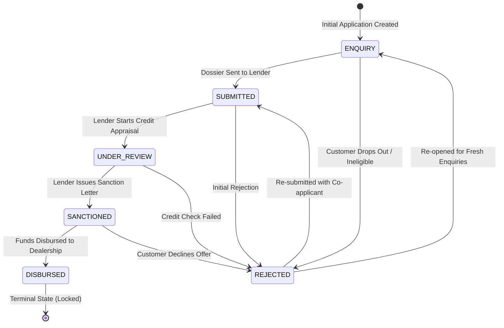

# Nexus ERP — Dealership Finance & Loan Desk API Specification

> **Document Status:** Reference implementation documentation for the existing `FinanceLoanModule` in repository `Nova5tech/Nexus_ERP` (`feature/finance-loan-backend-v2`).  
> **Source of Truth:** Backend codebase at commit `43bc424`. This document specifies actual implemented behavior, not a guarantee of external production deployment or third-party service availability.

---

## A. Module Overview

The **Finance & Loan Desk** module manages the vehicle financing pipeline for automotive dealerships within Nexus ERP. It provides endpoints for submitting customer loan applications, tracking lending institution review states, calculating dealership commissions, enforcing multi-tenant dealership branch access control, and aggregating real-time portfolio metrics for management dashboards.

### Dependencies & Database Entities
The module interacts with the following entities defined in [`backend/prisma/schema.prisma`](file:///c:/Users/goudt/OneDrive/Desktop/intern/ERP/backend/prisma/schema.prisma):

- **`LoanApplication`**: Primary entity storing customer name, lender institution, loan principal amount, interest rate, tenure months, dealership commission amount, lifecycle status, branch association, and submitting user identity.
- **`LoanStatus` (Enum)**: Pipeline states: `ENQUIRY`, `SUBMITTED`, `UNDER_REVIEW`, `SANCTIONED`, `DISBURSED`, `REJECTED`.
- **`Branch`**: Dealership location hosting the vehicle sale and loan application.
- **`User`**: Dealership staff member submitting and managing the loan file.

---

## B. Authentication and Authorization

All Finance & Loan Desk endpoints require authentication and are protected by `JwtAuthGuard` applied at the controller level.

### 1. Token Header Format
Requests must include a valid JSON Web Token (JWT) issued by `POST /api/auth/login` in the HTTP `Authorization` request header:

```http
Authorization: Bearer <access_token>
```

Tokens are validated by `JwtStrategy` using Passport JWT. Unauthenticated or malformed requests are rejected with:
- **HTTP 401 Unauthorized**: `{ "statusCode": 401, "message": "Unauthorized" }` or `{ "statusCode": 401, "message": "Invalid access token" }`

### 2. Multi-Tenant Branch Authorization
Every authenticated token contains the user's assigned branch identifiers (`branchIds: string[]`), roles (`roles: string[]`), and permissions (`permissions: string[]`).

- **`SYSTEM_ADMIN` Access:** Users possessing the `SYSTEM_ADMIN` role or permission are granted global visibility across all dealership branches without restriction. They can query metrics and loan listings across the entire enterprise or optionally filter by any specific `branchId`.
- **Branch Staff / Loan Officers:** Users without `SYSTEM_ADMIN` are restricted exclusively to their assigned branches (`user.branchIds`):
  - Requesting or submitting records for a branch outside their assigned list immediately throws **HTTP 403 Forbidden**:
    ```json
    {
      "statusCode": 403,
      "message": "Access denied: You do not have permission to access branch '<branchId>'.",
      "error": "Forbidden"
    }
    ```
  - Omitting the `branchId` filter automatically scopes database queries to `{ branchId: { in: user.branchIds } }`.
  - If a non-admin user has no assigned branches (`branchIds` is empty), queries safely return empty results (`total: 0`) and zeroed dashboard metrics.

### 3. Role Policy Scope
Fine-grained permission keys (e.g. `LOAN_APPROVE`, `LOAN_DISBURSE`) are prepared in the access foundation schema but lifecycle status transitions are currently governed by branch membership and the strict status transition state machine.

---

## C. Endpoint Reference

Base Route: `/api/finance/loans` (global prefix `/api` configured in [`backend/src/main.ts`](file:///c:/Users/goudt/OneDrive/Desktop/intern/ERP/backend/src/main.ts)).

### 1. List Loan Applications
Retrieves a paginated list of loan applications filtered by branch, status, lender, or customer name search.

- **HTTP Method:** `GET`
- **Route:** `/api/finance/loans`
- **Authentication:** Bearer JWT required (`JwtAuthGuard`)
- **Query Parameters ([`LoanQueryDto`](file:///c:/Users/goudt/OneDrive/Desktop/intern/ERP/backend/src/modules/finance-loan/dto/loan-query.dto.ts)):**
  - `page` *(optional, integer, min: 1, default: `1`)*: Current page number.
  - `limit` *(optional, integer, min: 1, max: 100, default: `20`)*: Records per page.
  - `status` *(optional, enum)*: One of `ENQUIRY`, `SUBMITTED`, `UNDER_REVIEW`, `SANCTIONED`, `DISBURSED`, `REJECTED`.
  - `lender` *(optional, string, max: 100 chars)*: Substring filter for lender name (case-insensitive).
  - `branchId` *(optional, string, max: 50 chars)*: Filter by dealership branch ID (verified against caller permissions).
  - `search` *(optional, string, max: 100 chars)*: Substring filter for customer name (case-insensitive).

#### Success Response (`HTTP 200 OK`)
```json
{
  "data": [
    {
      "id": "cmvf6b7sv0001fk9696zysav2",
      "customerName": "Ayesha Rao",
      "lenderName": "HDFC Bank",
      "loanAmount": "650000.00",
      "interestRate": "8.75",
      "tenureMonths": 48,
      "commissionAmount": "13000.00",
      "status": "ENQUIRY",
      "branchId": "branch-mumbai-1",
      "submittingUserId": "user-staff-1",
      "createdAt": "2026-10-22T08:00:00.000Z",
      "updatedAt": "2026-10-22T08:00:00.000Z",
      "branch": {
        "id": "branch-mumbai-1",
        "code": "MUM-01",
        "name": "Mumbai Central Showroom"
      },
      "submittingUser": {
        "id": "user-staff-1",
        "firstName": "Priya",
        "lastName": "Sharma",
        "email": "priya.sharma@nexus.local"
      }
    }
  ],
  "total": 1,
  "page": 1,
  "limit": 20,
  "totalPages": 1
}
```

---

### 2. Retrieve Portfolio Dashboard Metrics
Aggregates key financial and pipeline metrics for executive dashboard KPI cards and lender volume breakdown charts.

- **HTTP Method:** `GET`
- **Route:** `/api/finance/loans/metrics`
- **Authentication:** Bearer JWT required (`JwtAuthGuard`)
- **Query Parameters:**
  - `branchId` *(optional, string)*: Filter metrics by branch ID. If omitted, automatically scoped to caller's branch access.
- **Route Precedence:** Registered prior to `/:id` in `FinanceLoanController` to prevent route collision.

#### Success Response (`HTTP 200 OK`)
```json
{
  "totalApplications": 14,
  "activeLoans": 8,
  "disbursedCount": 4,
  "totalDisbursedAmount": 3800000,
  "totalCommissionEarned": 76000,
  "byStatus": {
    "ENQUIRY": { "count": 3, "totalAmount": 1500000 },
    "SUBMITTED": { "count": 3, "totalAmount": 1800000 },
    "UNDER_REVIEW": { "count": 2, "totalAmount": 1200000 },
    "SANCTIONED": { "count": 0, "totalAmount": 0 },
    "DISBURSED": { "count": 4, "totalAmount": 3800000 },
    "REJECTED": { "count": 2, "totalAmount": 900000 }
  },
  "byLender": [
    {
      "name": "HDFC Bank",
      "count": 6,
      "totalAmount": 3200000,
      "commission": 64000
    },
    {
      "name": "ICICI Bank",
      "count": 4,
      "totalAmount": 2100000,
      "commission": 42000
    }
  ]
}
```

---

### 3. Create Loan Application
Submits a new loan application. Automatically validates branch existence, caller authorization, sanitizes whitespace, and computes default 2% dealership commission if omitted.

- **HTTP Method:** `POST`
- **Route:** `/api/finance/loans`
- **Authentication:** Bearer JWT required (`JwtAuthGuard`)
- **Request Body ([`CreateLoanDto`](file:///c:/Users/goudt/OneDrive/Desktop/intern/ERP/backend/src/modules/finance-loan/dto/create-loan.dto.ts)):**
  | Field | Type | Required | Constraints / Validation |
  | :--- | :--- | :---: | :--- |
  | `customerName` | String | **Yes** | Trimmed, non-empty, max 150 characters. |
  | `lenderName` | String | **Yes** | Trimmed, non-empty, max 100 characters. |
  | `loanAmount` | Number | **Yes** | Positive number, min `1`, max `1,000,000,000` (fits `DECIMAL(14,2)`). |
  | `interestRate` | Number | **Yes** | Number, min `0.0`, max `100.0` (percentage). |
  | `tenureMonths` | Integer | **Yes** | Positive integer, min `1`, max `360` (up to 30 years). |
  | `commissionAmount` | Number | *Optional* | Min `0.0`, max `100,000,000`. If omitted, defaults to `loanAmount * 0.02` rounded to 2 decimal places. |
  | `branchId` | String | **Yes** | Trimmed, non-empty, max 50 characters. Must reference an active `Branch`. |

#### Sample Request Payload
```json
{
  "customerName": "Rahul Verma",
  "lenderName": "State Bank of India",
  "loanAmount": 750000,
  "interestRate": 8.5,
  "tenureMonths": 60,
  "branchId": "branch-mumbai-1"
}
```

#### Success Response (`HTTP 201 Created`)
```json
{
  "id": "cmvf8a2bc0002fk9601pqr999",
  "customerName": "Rahul Verma",
  "lenderName": "State Bank of India",
  "loanAmount": "750000.00",
  "interestRate": "8.50",
  "tenureMonths": 60,
  "commissionAmount": "15000.00",
  "status": "ENQUIRY",
  "branchId": "branch-mumbai-1",
  "submittingUserId": "user-staff-1",
  "createdAt": "2026-10-22T08:30:00.000Z",
  "updatedAt": "2026-10-22T08:30:00.000Z",
  "branch": {
    "id": "branch-mumbai-1",
    "code": "MUM-01",
    "name": "Mumbai Central Showroom"
  },
  "submittingUser": {
    "id": "user-staff-1",
    "firstName": "Priya",
    "lastName": "Sharma",
    "email": "priya.sharma@nexus.local"
  }
}
```

#### Error Conditions
- `400 Bad Request`: Input validation failed (e.g. non-integer tenure, negative amount, missing fields, or branch is inactive).
- `401 Unauthorized`: Missing or invalid Bearer token.
- `403 Forbidden`: User does not possess access rights for the target `branchId`.

---

### 4. Retrieve Single Loan Application
Fetches the full record of a loan application by its unique ID.

- **HTTP Method:** `GET`
- **Route:** `/api/finance/loans/:id`
- **Authentication:** Bearer JWT required (`JwtAuthGuard`)
- **Path Parameters:**
  - `id` *(string)*: Unique identifier (`cuid()`).

#### Success Response (`HTTP 200 OK`)
Returns the complete loan record with joined `branch` and `submittingUser` objects.

#### Error Conditions
- `400 Bad Request`: Malformed or empty `id` parameter.
- `404 Not Found`: Loan record does not exist (`Loan application with ID '<id>' was not found.`).
- `403 Forbidden`: Loan exists, but caller lacks authorization for the loan's branch.

---

### 5. Update Loan Lifecycle Status
Advances the application through the dealership lending lifecycle while enforcing the finite state machine.

- **HTTP Method:** `PATCH`
- **Route:** `/api/finance/loans/:id/status`
- **Authentication:** Bearer JWT required (`JwtAuthGuard`)
- **Path Parameters:**
  - `id` *(string)*: Target loan identifier.
- **Request Body ([`UpdateLoanStatusDto`](file:///c:/Users/goudt/OneDrive/Desktop/intern/ERP/backend/src/modules/finance-loan/dto/update-loan-status.dto.ts)):**
  | Field | Type | Required | Allowed Values |
  | :--- | :--- | :---: | :--- |
  | `status` | Enum | **Yes** | `ENQUIRY`, `SUBMITTED`, `UNDER_REVIEW`, `SANCTIONED`, `DISBURSED`, `REJECTED` |

#### Sample Request Payload
```json
{
  "status": "SUBMITTED"
}
```

#### Success Response (`HTTP 200 OK`)
Returns the updated loan application object reflecting the new status and updated timestamp.

#### Error Conditions
- `400 Bad Request`: Invalid transition (e.g., jumping from `ENQUIRY` directly to `DISBURSED`, or modifying a record already in terminal `DISBURSED` status).
- `403 Forbidden`: Caller lacks authorization for the application's branch.
- `404 Not Found`: Loan application ID does not exist.

---

## D. Loan Lifecycle & State Machine

Status transitions strictly enforce dealership compliance. Terminal records cannot be altered, and arbitrary state skipping is blocked.



### Transition Rule Table
| From State | Allowed Next States | Terminal? | Behavior on Invalid Transition |
| :--- | :--- | :---: | :--- |
| **`ENQUIRY`** | `SUBMITTED`, `REJECTED` | No | `HTTP 400`: *"Allowed next states: SUBMITTED, REJECTED."* |
| **`SUBMITTED`** | `UNDER_REVIEW`, `REJECTED` | No | `HTTP 400`: *"Allowed next states: UNDER_REVIEW, REJECTED."* |
| **`UNDER_REVIEW`** | `SANCTIONED`, `REJECTED` | No | `HTTP 400`: *"Allowed next states: SANCTIONED, REJECTED."* |
| **`SANCTIONED`** | `DISBURSED`, `REJECTED` | No | `HTTP 400`: *"Allowed next states: DISBURSED, REJECTED."* |
| **`DISBURSED`** | *(None)* | **Yes** | `HTTP 400`: *"This application is in a terminal state and cannot be changed."* |
| **`REJECTED`** | `ENQUIRY`, `SUBMITTED` | No | Allows file re-opening or re-submission. |

*Idempotency:* If a request supplies the status the record already holds (`currentStatus === nextStatus`), the service returns the existing record without throwing an error.

---

## E. Pagination and Filtering

Implemented in `FinanceLoanService.findAll()`:

1. **Pagination Parameters:**
   - `page`: Evaluated as `Math.max(1, query.page ?? 1)`. Non-positive numbers default to page `1`.
   - `limit`: Evaluated as `Math.max(1, Math.min(100, query.limit ?? 20))`. Clamped between 1 and 100.
   - `skip`: Calculated as `(page - 1) * limit`.
2. **Filtering Semantics:**
   - `status`: Exact match against `LoanStatus` enum.
   - `lender`: Substring match on `lenderName` with `mode: 'insensitive'`.
   - `search`: Substring match on `customerName` with `mode: 'insensitive'`.
   - `branchId`: Scoped according to caller's branch access rights.
3. **Response Metadata:**
   Every list response includes pagination metadata:
   - `total`: Total matching records in database.
   - `page`: Current page number.
   - `limit`: Page size.
   - `totalPages`: `Math.ceil(total / limit)`.

---

## F. Dashboard Metrics Aggregation

Calculated in `FinanceLoanService.getMetrics()`:

- **`totalApplications`**: Total count of applications in the requested branch scope.
- **`activeLoans`**: Applications in active workflow (`status != DISBURSED && status != REJECTED`).
- **`disbursedCount`**: Applications that reached `DISBURSED`.
- **`totalDisbursedAmount`**: Sum of `loanAmount` for all `DISBURSED` records, rounded to 2 decimal places.
- **`totalCommissionEarned`**: Sum of `commissionAmount` for all `DISBURSED` records, rounded to 2 decimal places.
- **`byStatus`**: Status map recording `{ count, totalAmount }` for every status present in the dataset.
- **`byLender`**: Array of lender metrics `{ name, count, totalAmount, commission }` sorted in **descending order by total loan volume** (`b.totalAmount - a.totalAmount`).

---

## G. Validation and Error Responses

Requests are validated before entering controller methods by NestJS's global `ValidationPipe({ whitelist: true, transform: true })`.

### 1. Example: Invalid Request (HTTP 400 Bad Request)
**Request:**
```http
POST /api/finance/loans
Content-Type: application/json
Authorization: Bearer <valid_token>

{
  "customerName": "   ",
  "lenderName": "",
  "loanAmount": -500,
  "interestRate": 150,
  "tenureMonths": 12.5,
  "branchId": ""
}
```

**Response (`HTTP 400 Bad Request`):**
```json
{
  "message": [
    "Customer name is required",
    "Lender name is required",
    "Loan amount must be greater than zero",
    "Loan amount must be at least 1",
    "Interest rate cannot exceed 100%",
    "Tenure must be an integer number of months",
    "Branch ID is required"
  ],
  "error": "Bad Request",
  "statusCode": 400
}
```

### 2. Example: Unauthorized Cross-Branch Query (HTTP 403 Forbidden)
**Response (`HTTP 403 Forbidden`):**
```json
{
  "statusCode": 403,
  "message": "Access denied: You do not have permission to access branch 'branch-pune-2'.",
  "error": "Forbidden"
}
```

---

## H. Local Development Setup

### 1. Prerequisites
- Node.js v20+ / v24+
- PostgreSQL 16+ (Local service or Docker container)

### 2. Environment Configuration ([`backend/.env`](file:///c:/Users/goudt/OneDrive/Desktop/intern/ERP/backend/.env))
Create `backend/.env` using [`backend/.env.example`](file:///c:/Users/goudt/OneDrive/Desktop/intern/ERP/backend/.env.example) as template:

```ini
PORT=3000
NODE_ENV=development
FRONTEND_ORIGIN=http://localhost:5173
JWT_SECRET=your_jwt_secret_must_be_at_least_32_characters_long

# PostgreSQL Connection String (Prisma 7)
DATABASE_URL=postgresql://<DB_USER>:<DB_PASSWORD>@localhost:5433/nexus_erp?schema=public

# Initial Bootstrap Admin Seed Credentials
BOOTSTRAP_ADMIN_EMAIL=admin@nexus.local
BOOTSTRAP_ADMIN_FIRST_NAME=Admin
BOOTSTRAP_ADMIN_LAST_NAME=User
BOOTSTRAP_ADMIN_PASSWORD=YourSecurePassword123!
```

### 3. Database Migration & Validation Commands
From the `backend/` directory:
```bash
# Verify Prisma schema validity
npx prisma validate

# Check migration status
npx prisma migrate status

# Apply migrations in development
npx prisma migrate dev

# Seed bootstrap admin account
npx ts-node prisma/seed-admin.ts
```

### 4. Build & Test Commands
```bash
# Run unit test suite (28 tests across Auth & Finance Loan modules)
npm test

# Build production TypeScript output into dist/
npm run build

# Start development server with live reload
npm run start:dev

# Start production server
npm run start:prod
```

---

## I. Current Limitations & Pending Work

1. **HTTP End-to-End (E2E) Integration Tests:** The 28 automated tests currently execute unit tests with isolated mocks. Live HTTP supertest integration tests against a running PostgreSQL test container are scheduled for Phase 2.
2. **General Ledger Commission Accounting:** When a loan reaches `DISBURSED`, automatic double-entry posting to the General Ledger (Debit: Commission Receivable, Credit: Commission Revenue) is pending contract finalization with Akash's Finance & Accounting module.
3. **Lender Master Normalization:** Lenders are currently recorded as validated strings on loan applications. Normalization into a dedicated `Lender` table with commission slabs is planned for subsequent milestones.
4. **Loan Document Attachments:** Document upload endpoints (KYC documents, sanction letters, RC books) are pending AWS S3 / MinIO storage integration.
