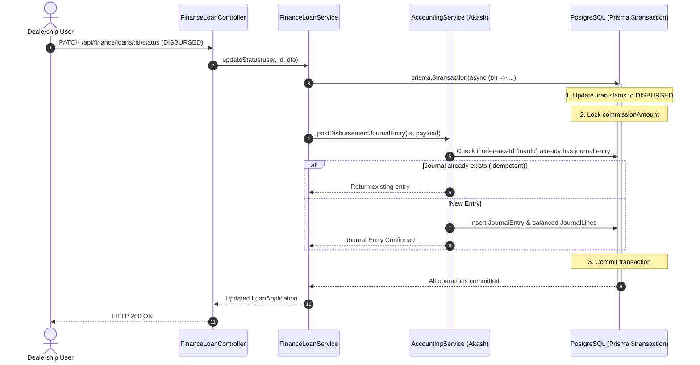
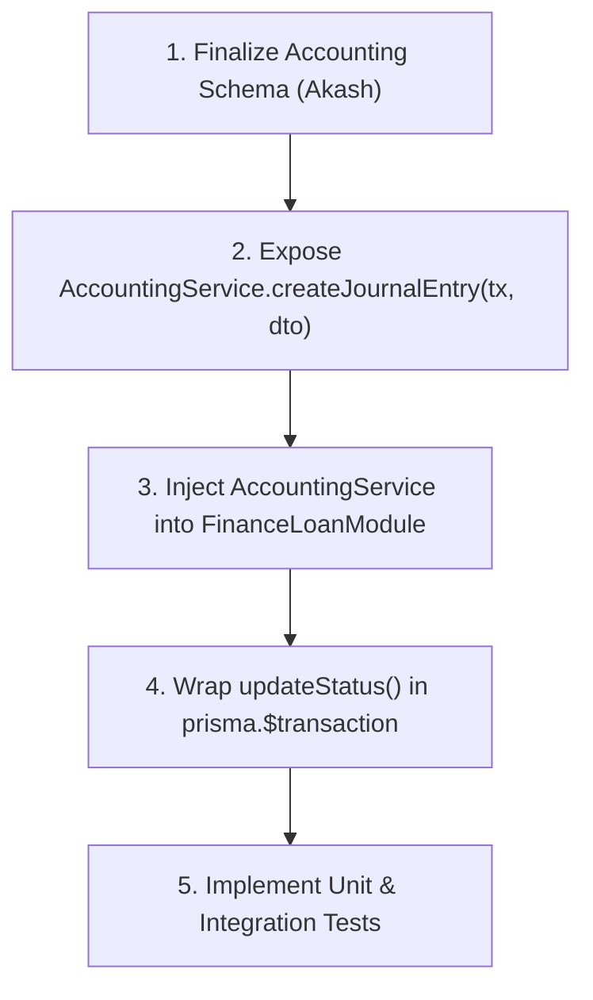

# Nexus ERP — Finance & Loan Desk to General Ledger Integration Architecture Plan

> **Document Status:** Architectural specification and integration proposal.  
> **Source of Truth:** Codebase state on branch `feature/finance-loan-backend-v2` at commit `43bc424`.  
> **Target Audience:** Engineering Management, Akash (Lead Engineer, Finance & Accounting), and Finance Stakeholders.

---

## 1. Executive Summary

This document establishes the technical blueprint for integrating the completed **Dealership Finance & Loan Desk** module with the upcoming **General Ledger (GL) & Financial Accounting** module in Nexus ERP.

An exhaustive inspection of the current backend codebase confirms that:
1. **No backend General Ledger module currently exists** in `backend/src/modules/`. The current modules are `auth`, `health`, and `finance-loan`.
2. **No accounting tables exist** in [`backend/prisma/schema.prisma`](file:///c:/Users/goudt/OneDrive/Desktop/intern/ERP/backend/prisma/schema.prisma) (no `JournalEntry`, `Account`, `FiscalPeriod`, or `LedgerPosting`).
3. An unintegrated frontend prototype exists at [`frontend/src/modules/finance-accounting/FinanceAccounting.tsx`](file:///c:/Users/goudt/OneDrive/Desktop/intern/ERP/frontend/src/modules/finance-accounting/FinanceAccounting.tsx) defining a mock Chart of Accounts.

This plan details how the Finance & Loan Desk will trigger double-entry journal entries upon loan disbursement once Akash's Accounting module is introduced, using atomic database transactions, strict idempotency, and non-destructive failure recovery.

---

## 2. Existing Architecture & Verified Repository State

### A. Implemented Backend Modules
| Module | Directory | Current Scope & Entities |
| :--- | :--- | :--- |
| **`AuthModule`** | `backend/src/modules/auth` | JWT issuance, password verification, `User`, `Role`, `Permission`, `UserBranch`. |
| **`HealthModule`** | `backend/src/modules/health` | Liveness (`/api/health`) and PostgreSQL connection readiness (`/api/health/ready`). |
| **`FinanceLoanModule`** | `backend/src/modules/finance-loan` | Loan pipeline (`LoanApplication`, `LoanStatus`), 5 REST endpoints, DTO validation, branch access control. |

### B. Verified General Ledger State
- **Backend General Ledger Services:** **None**. No `AccountingService`, `LedgerService`, or `JournalEntryController` exists in the backend.
- **Database Schema:** No accounting or ledger models exist in `schema.prisma`.
- **Frontend Accounting Mock:** [`FinanceAccounting.tsx`](file:///c:/Users/goudt/OneDrive/Desktop/intern/ERP/frontend/src/modules/finance-accounting/FinanceAccounting.tsx) provides a mock Chart of Accounts containing:
  - Account `1000`: *Cash & Bank* (Asset)
  - Account `1100`: *Accounts Receivable* (Asset)
  - Account `4300`: *Finance & Insurance Commission* (Revenue)
  - Account `2100`: *GST Payable* (Liability)

---

## 3. Finance & Loan Desk Lifecycle & Disbursement Trigger

### A. How a Loan Transitions to `DISBURSED`
A dealership user issues an HTTP request:
```http
PATCH /api/finance/loans/:id/status
Content-Type: application/json
Authorization: Bearer <token>

{
  "status": "DISBURSED"
}
```

The request is processed by `FinanceLoanService.updateStatus()`:
1. **Branch Authorization:** Validates caller's access to the application's `branchId`.
2. **Finite State Machine:** Checks `ALLOWED_STATUS_TRANSITIONS`. Transition to `DISBURSED` is allowed **strictly from `SANCTIONED`**. Transitions directly from `ENQUIRY`, `SUBMITTED`, or `UNDER_REVIEW` throw `BadRequestException` (HTTP 400).
3. **Terminal Lock:** Once `DISBURSED`, `ALLOWED_STATUS_TRANSITIONS['DISBURSED'] = []`. Any subsequent request attempting to modify or reopen the record is blocked with:
   `"This application is in a terminal state and cannot be changed."`

### B. Data Available at Disbursement
When a loan reaches `DISBURSED`, the following fields are locked and available:
- `id`: Unique loan application ID (`cuid()`).
- `customerName`: String (e.g. `"Ayesha Rao"`).
- `lenderName`: Lending institution (e.g. `"HDFC Bank"`, `"State Bank of India"`).
- `loanAmount`: Principal financed amount (`Decimal(14,2)`).
- `interestRate`: Annual interest rate (`Decimal(5,2)`).
- `tenureMonths`: Loan duration (`Int`).
- `commissionAmount`: Dealership payout (`Decimal(12,2)`, e.g. `15000.00`).
- `branchId`: Dealership branch hosting the transaction.
- `submittingUserId`: Employee ID who originated the file.
- `updatedAt`: Timestamp of disbursement.

---

## 4. Proposed Accounting Trigger & Journal Entry Contract

### A. The Business Trigger
**When:** The loan status advances from `SANCTIONED` to `DISBURSED`.  
**Why:** Disbursement signifies that the lender has released financing for the vehicle. Under standard accrual accounting, the dealership's commission revenue is earned at this moment.

### B. Proposed Journal Entry Contract
The Finance & Loan module will call Akash's `AccountingService` (or internal contract) with a standardized payload:

```typescript
export interface CreateDisbursementJournalEntryDto {
  referenceId: string;           // LoanApplication.id (for deduplication)
  referenceType: 'LOAN_DISBURSEMENT';
  branchId: string;              // Dealership branch ID
  effectiveDate: Date;           // Disbursement timestamp
  narration: string;             // Human-readable ledger audit note
  lines: Array<{
    accountCode: string;         // Chart of accounts identifier
    description: string;
    debitAmount: number;
    creditAmount: number;
  }>;
}
```

### C. Proposed Double-Entry Accounting Mapping

#### Scenario 1: Standard Accrual (Dealer Payout Receivable)
*When commission is earned on disbursement and settled by the lender later:*

| Line | Account Code | Account Name | Account Type | Debit (₹) | Credit (₹) |
| :---: | :---: | :--- | :---: | :---: | :---: |
| **1** | `1100` *(Placeholder)* | Dealer Commission Receivable | Asset | `15,000.00` | — |
| **2** | `4300` *(Placeholder)* | F&I Commission Revenue | Revenue | — | `15,000.00` |

*Balancing Check:* Total Debits (`₹15,000.00`) = Total Credits (`₹15,000.00`). Balance Delta = `0.00`.

#### Scenario 2: If GST is Legally Applicable on Dealership Commission
*Dealership commission payouts in India are often subject to 18% GST (9% CGST + 9% SGST):*

| Line | Account Code | Account Name | Account Type | Debit (₹) | Credit (₹) |
| :---: | :---: | :--- | :---: | :---: | :---: |
| **1** | `1100` | Commission Receivable (Lender) | Asset | `17,700.00` | — |
| **2** | `4300` | F&I Commission Revenue | Revenue | — | `15,000.00` |
| **3** | `2100` | GST Output Liability (18%) | Liability | — | `2,700.00` |

> [!IMPORTANT]
> **Finance Decision Required:** The finance management team must confirm whether GST is bundled into `commissionAmount` or calculated additively prior to journal creation.

---

## 5. Transaction & Idempotency Strategy

Because Nexus ERP operates as a **NestJS modular monolith** with a shared PostgreSQL database, the safest integration mechanism is a **Prisma Interactive Transaction (`prisma.$transaction`)**.



### Key Idempotency Safeguards:
1. **Idempotent Status Check:** If `loan.status === 'DISBURSED'` and a client resends `{ "status": "DISBURSED" }`, `FinanceLoanService` detects `currentStatus === nextStatus` and returns the existing record immediately without calling the ledger.
2. **Unique Database Reference Constraint:** The accounting table must enforce `@@unique([referenceId, referenceType])` on `JournalEntry`. Any duplicate attempt to post a journal entry for the same loan ID will be rejected by the database.

---

## 6. Error Handling & Partial Failure Recovery

1. **Atomic All-or-Nothing Rollback:**
   - If `AccountingService` throws an exception (e.g. fiscal year is closed, account code invalid, debit/credit imbalance), the Prisma transaction immediately rolls back.
   - The loan status remains `SANCTIONED` in the database.
   - The client receives a descriptive error (e.g. `HTTP 422 Unprocessable Entity: General Ledger validation failed`), and zero corrupt or orphaned records are written.
2. **Reversal & Correction Workflow:**
   - If a loan is disbursed by mistake, financial compliance dictates that journal entries **must never be hard-deleted**.
   - A dedicated reversal method (`createJournalReversal(referenceId)`) must post an offsetting entry (Debit: Revenue, Credit: Receivable) with an audit reference linking back to the original entry.

---

## 7. Authorization & Role-Based Permissions (RBAC)

### Existing Permission Findings:
- The database schema supports granular permissions via `RolePermission` and `Permission`.
- However, permission strings such as `LOAN_DISBURSE` or `LOAN_APPROVE` are not currently seeded in `seed-admin.ts` nor enforced in `FinanceLoanController`.
- Currently, **any authenticated user assigned to a dealership branch** can advance a loan from `SANCTIONED` to `DISBURSED`.

### Proposed Authorization Policy:
1. **Define Permissions:** Seed `LOAN_CREATE`, `LOAN_APPROVE`, and `LOAN_DISBURSE` into the `Permission` table.
2. **Role Mapping:**
   - `LOAN_OFFICER`: Can create and submit loans (`ENQUIRY` ➔ `SUBMITTED`).
   - `FINANCE_MANAGER`: Can sanction and disburse loans (`UNDER_REVIEW` ➔ `SANCTIONED` ➔ `DISBURSED`).
   - `SYSTEM_ADMIN`: Global override across all branches and lifecycle states.
3. **Guard Implementation:** Apply `@RequirePermissions('LOAN_DISBURSE')` to `updateStatus()` when `dto.status === 'DISBURSED'`.

---

## 8. Minimal Implementation Steps (Once Ledger Exists)



1. **Step 1:** Akash creates `JournalEntry` and `JournalLine` models in `schema.prisma` with `referenceId` and `referenceType`.
2. **Step 2:** Akash exposes an exported `AccountingService` accepting an optional Prisma transaction client (`tx: Prisma.TransactionClient`).
3. **Step 3:** Import `AccountingModule` into [`finance-loan.module.ts`](file:///c:/Users/goudt/OneDrive/Desktop/intern/ERP/backend/src/modules/finance-loan/finance-loan.module.ts).
4. **Step 4:** In `FinanceLoanService.updateStatus()`, wrap the status update and journal posting in `this.prisma.$transaction(async (tx) => ...)`.
5. **Step 5:** Write unit tests mocking `AccountingService` to verify that failure to post rolls back the status update.

---

## 9. Tests Required Prior to Implementation

1. **Journal Creation Unit Test:** Verify that transitioning to `DISBURSED` generates the exact debit/credit amounts matching `commissionAmount`.
2. **Atomic Rollback Test:** Verify that when `accountingService.createJournalEntry()` throws an error, the loan application remains in `SANCTIONED` status.
3. **Idempotency Test:** Verify that repeated status update requests do not trigger duplicate calls to `AccountingService`.
4. **GST Precision Test:** Verify that rounding logic maintains balanced debit/credit sums to the exact rupee cent.

---

## 10. Open Decisions for Akash & Finance Stakeholders

| # | Question / Decision Item | Primary Stakeholder | Current Status |
| :-: | :--- | :---: | :---: |
| **1** | What are the exact confirmed Account Codes for Commission Receivable and Commission Revenue? | Finance Management | Unconfirmed (Using `1100` and `4300` as placeholders) |
| **2** | Is GST (18%) applicable to dealership finance commissions, and should it be separated in the disbursement entry? | Tax / Finance Compliance | Unconfirmed |
| **3** | Will `AccountingService` accept an interactive Prisma transaction client (`tx`) for atomic cross-module operations? | Akash (Backend Lead) | Proposed architecture |
| **4** | Who is authorized to trigger `DISBURSED` status (e.g. `FINANCE_MANAGER` only)? | Management | Open policy decision |

---

*Authored by: Senior Backend & Financial Systems Engineer*  
*Repository: Nova5tech/Nexus_ERP (`backend/docs/finance-loan-ledger-integration-plan.md`)*
