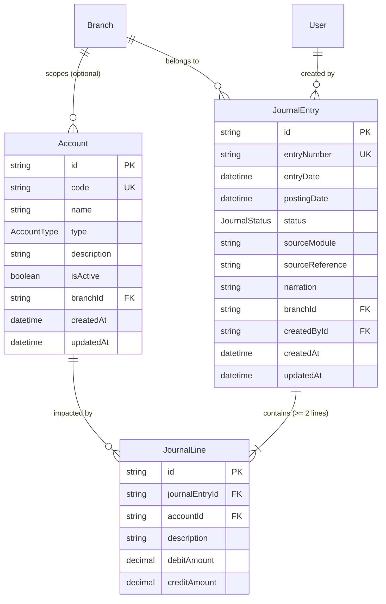

# Nexus ERP General Ledger Backend Foundation Architecture & Design

## 1. Overview & Context

This document details the General Ledger (GL) backend foundation for Nexus ERP, implemented in NestJS with Prisma ORM and PostgreSQL. The foundation provides double-entry bookkeeping, chart of accounts management, multi-branch scoping, and transactional idempotency.

The implementation establishes a clean, decoupled accounting core designed to receive automated postings from upstream operational modules (e.g., Finance & Loan Desk, Vehicle Sales, Service & Spare Parts) without tight coupling.

---

## 2. Architecture & Domain Model

The General Ledger module resides in `backend/src/modules/general-ledger/` and is registered in `AppModule`.

### 2.1 Entity Relationship Diagram



### 2.2 Enums & Lifecycle

- **AccountType**:
  - `ASSET`: Economic resources (e.g., Cash, Bank, Accounts Receivable, Inventory).
  - `LIABILITY`: Obligations (e.g., Accounts Payable, GST Payable, Customer Deposits).
  - `EQUITY`: Ownership interest / retained earnings.
  - `REVENUE`: Operating income (e.g., Commission Income, Vehicle Sales Revenue).
  - `EXPENSE`: Operating expenses (e.g., Bank Charges, Subvention Costs, Overheads).
- **JournalStatus**:
  - `DRAFT`: Unposted provisional entries (`postingDate: null`). Can be finalized via `/post`.
  - `POSTED`: Immutable, active financial journal entry with `postingDate`. Cannot be deleted or modified.
  - `VOID`: Reversed/cancelled entry preserving full audit trail.

---

## 3. Core Accounting Invariants

The `GeneralLedgerService` strictly enforces the following accounting rules at runtime before persisting records:

1. **Exact Double-Entry Balancing**:
   - $\sum \text{Debits} = \sum \text{Credits}$
   - Calculated using integer cents (`Math.round(amount * 100)`) to avoid IEEE-754 floating-point inaccuracies.
   - Throws `BadRequestException` if debits do not match credits.
2. **Single-Sided Line Validation**:
   - Each line must contain either a debit amount ($> 0$) or a credit amount ($> 0$), but never both and never neither.
   - Amounts cannot be negative.
3. **Decimal Precision Guard**:
   - Fractional cents (more than 2 decimal places) are strictly rejected with `BadRequestException`.
4. **Minimum Line Count**:
   - Every journal entry must have at least 2 lines. Entries with fewer lines are rejected with `BadRequestException`.
5. **Account State & Branch Compatibility**:
   - Accounts referenced in journal lines must exist and have `isActive = true`.
   - If an account is scoped to a specific branch (`account.branchId` is set), it cannot be used in a journal entry for another branch.
   - Global accounts (`account.branchId = null`) can be utilized across all branches.
6. **Atomic Transaction Boundary**:
   - All entries and their constituent lines are written inside `prisma.$transaction(async (tx) => ...)`.
   - If line creation, sequence generation, or account validation fails, the entire transaction rolls back completely.
7. **Idempotency & Concurrency Protection**:
   - If a source identifier is provided, both `sourceModule` and `sourceReference` must be provided together. Partial identifiers are rejected.
   - Idempotency is enforced by pre-check and by the PostgreSQL compound unique constraint `@@unique([sourceModule, sourceReference])`. Concurrent race collisions (Prisma `P2002`) are caught and mapped to `ConflictException`.
8. **Immutability of Financial History**:
   - No endpoints exist to update lines or amounts of posted journal entries.
   - No endpoints exist to delete journal entries.
   - The only supported state transitions are `POST` (from `DRAFT` to `POSTED`) and `VOID` (from `POSTED` to `VOID`), both preserving line items and recording audit narration.

---

## 4. Multi-Tenant Branch Isolation

Access control mirrors Nexus ERP's dealership organizational hierarchy:

- **Users with `SYSTEM_ADMIN` role**:
  - Unrestricted read and write access across all branches.
  - Can post entries, void entries, and create accounts for any registered branch.
- **Branch-scoped users (e.g., Accountants, Loan Officers)**:
  - Can only post journal entries and view entries for branches included in their JWT `branchIds` array.
  - Cross-branch access attempts are rejected with `ForbiddenException`.
  - Account queries return both global accounts (`branchId = null`) and accounts matching the user's permitted branches.

---

## 5. REST API Reference

All endpoints require standard JWT Bearer authentication via `JwtAuthGuard`.

### 5.1 Chart of Accounts

#### `POST /api/ledger/accounts`
Create a new ledger account.
- **Request Body**:
  ```json
  {
    "code": "1100",
    "name": "Accounts Receivable - Commissions",
    "type": "ASSET",
    "description": "Accrued commission receivable from lenders",
    "branchId": "branch-mumbai"
  }
  ```
- **Responses**:
  - `201 Created`: Account created successfully.
  - `400 Bad Request`: Validation failure.
  - `409 Conflict`: Code already exists.

#### `GET /api/ledger/accounts`
List accounts with optional filtering by type, branch, active status, or search query.
- **Query Parameters**:
  - `type` (`ASSET` | `LIABILITY` | `EQUITY` | `REVENUE` | `EXPENSE`)
  - `branchId` (string)
  - `isActive` (boolean)
  - `search` (string)
- **Response**: `200 OK` Array of `Account` records.

#### `GET /api/ledger/accounts/:id`
Retrieve account details by ID.
- **Response**: `200 OK` or `404 Not Found`.

---

### 5.2 Journal Entries

#### `POST /api/ledger/journal-entries`
Create a journal entry (status `POSTED` by default, or `DRAFT` if requested).
- **Request Body**:
  ```json
  {
    "entryDate": "2026-10-22T00:00:00.000Z",
    "narration": "Disbursement commission recognized for Loan LN-2026-0042",
    "branchId": "branch-mumbai",
    "status": "POSTED",
    "sourceModule": "FINANCE_LOAN",
    "sourceReference": "cuid-loan-0042",
    "lines": [
      {
        "accountId": "acc-ar-id",
        "description": "Commission receivable - HDFC Bank",
        "debitAmount": 15000.00,
        "creditAmount": 0.00
      },
      {
        "accountId": "acc-rev-id",
        "description": "Commission income from auto loan desk",
        "debitAmount": 0.00,
        "creditAmount": 15000.00
      }
    ]
  }
  ```
- **Responses**:
  - `201 Created`: Journal entry created with generated `entryNumber` (e.g., `JE-20261022-0001`).
  - `400 Bad Request`: Unbalanced debits/credits, inactive account, fractional cents, or invalid lines.
  - `409 Conflict`: Duplicate entry for `(sourceModule, sourceReference)`.

#### `GET /api/ledger/journal-entries`
Paginated search for journal entries.
- **Query Parameters**:
  - `page` (default: 1)
  - `limit` (default: 20, max: 100)
  - `status` (`DRAFT`, `POSTED`, `VOID`)
  - `branchId` (string)
  - `sourceModule` (string)
  - `sourceReference` (string)
  - `startDate`, `endDate` (ISO 8601 strings)
  - `search` (entry number or narration)
- **Response**: `200 OK` `{ data, total, page, limit, totalPages }`.

#### `GET /api/ledger/journal-entries/:id`
Retrieve full journal entry details, including lines and linked accounts.
- **Response**: `200 OK` or `404 Not Found`.

#### `POST /api/ledger/journal-entries/:id/post`
Finalize and post a draft journal entry.
- **Responses**:
  - `200 OK`: Status updated to `POSTED` with timestamped `postingDate`.
  - `400 Bad Request`: If entry is already posted or voided.
  - `403 Forbidden`: Cross-branch access denied.
  - `404 Not Found`: Entry does not exist.

#### `POST /api/ledger/journal-entries/:id/void`
Void a posted journal entry while preserving audit history.
- **Request Body** (optional):
  ```json
  {
    "reason": "Customer cancelled financing prior to delivery"
  }
  ```
- **Responses**:
  - `200 OK`: Status updated to `VOID`, audit reason appended to narration.
  - `400 Bad Request`: If entry is already voided or not in `POSTED` status.
  - `403 Forbidden`: Cross-branch access denied.
  - `404 Not Found`: Entry does not exist.

---

## 6. Upstream Integration with Finance & Loan Desk

The Finance & Loan Desk module (`FinanceLoanService`) tracks loan applications through the lifecycle `ENQUIRY -> SUBMITTED -> UNDER_REVIEW -> SANCTIONED -> DISBURSED`.

When an application transitions to `DISBURSED`, financial recognition occurs.

### Integration Approach:
1. **Decoupled Account Resolution**:
   - Rather than hardcoding account codes in `FinanceLoanService`, an accounting configuration mapping (e.g., `LOAN_COMMISSION_RECEIVABLE` -> `Account`, `LOAN_COMMISSION_REVENUE` -> `Account`) will be resolved per dealership branch.
2. **Atomic Upstream Invocation**:
   - `FinanceLoanService.updateStatus` will invoke `GeneralLedgerService.createJournalEntry` passing `sourceModule: 'FINANCE_LOAN'` and `sourceReference: loan.id`.
   - The transaction boundary guarantees that if the ledger entry posting fails, the loan status update rolls back cleanly.
3. **Idempotency Guard**:
   - The unique constraint `@@unique([sourceModule, sourceReference])` ensures that any retries or network replays cannot double-post commission revenue.

---

## 7. Migration & Schema Changes

Prisma schema migration `20261022144500_add_general_ledger_foundation`:
- Adds `AccountType` and `JournalStatus` enums.
- Creates `Account`, `JournalEntry`, and `JournalLine` tables.
- Adds foreign key constraints to `branches` and `users`.
- Adds compound unique index on `journal_entries(source_module, source_reference)`.
- Generated and validated using Prisma 7.10.1.
